# spec-workflow 看板使用说明与操作手册

> 适用版本：spec-workflow MCP v2.2.7（本地定制版）｜ 编写日期：2026-10-29 ｜ 更新日期：2026-10-31
>
> 看板地址：`http://localhost:5001`（开机自动启动，打开浏览器直接访问即可；为什么不是 5000 见第 11 节）

看板是 spec-workflow 的网页控制台。AI 负责写文档和代码，你在看板上做三件事：**看进度、审文档、查记录**。其中最重要的是审批：AI 写完每一份需求、设计、任务清单后都会停下来，等你在看板上审批通过，才继续下一步。

本手册截图来自示例项目 cursor 中的演示规范「Demo Dashboard Tour」，拍摄于本手册编写时，个别界面细节与当前不同（例如截图里的左侧导航还没有「使用手册」），以文字说明为准。

---

## 1. 界面总览

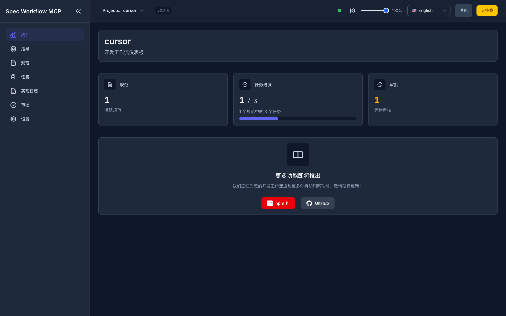

看板分三块：

- **左侧导航**：8 个页面，依次是统计、指导、规范、任务、实现日志、审批、设置、使用手册。点左上角 `«` 可以收起导航栏。
- **顶部工具栏**：切换项目、查看版本、设置提示音、语言和深浅色。
- **中间内容区**：当前页面的内容。

### 1.1 顶部工具栏

| 位置（从左到右） | 名称 | 作用 |
| --- | --- | --- |
| `Projects: cursor ▾` | 项目切换 | 选择要查看哪个项目。下拉框里列出所有已登记的项目，可以搜索 |
| `v2.2.5` | 版本号 | 点击查看更新日志。这里显示的是 npm 上发布的最新版本号，不是本机实际运行的版本（本机运行的是 v2.2.7 定制版） |
| 绿色圆点 | 连接状态 | 绿色表示看板和后台服务连接正常，页面数据会自动刷新 |
| 喇叭图标和滑块 | 提示音 | 有新审批时会播放提示音。点喇叭静音，拖滑块调音量 |
| 语言下拉框 | 界面语言 | 支持中文、英文、日文等 11 种语言。界面不是中文时，在这里选「🇨🇳 中文」 |
| `深色` | 主题 | 在深色和浅色之间切换 |
| `支持我` | 赞助链接 | 打开作者的赞助页面，和使用无关 |

### 1.2 切换项目

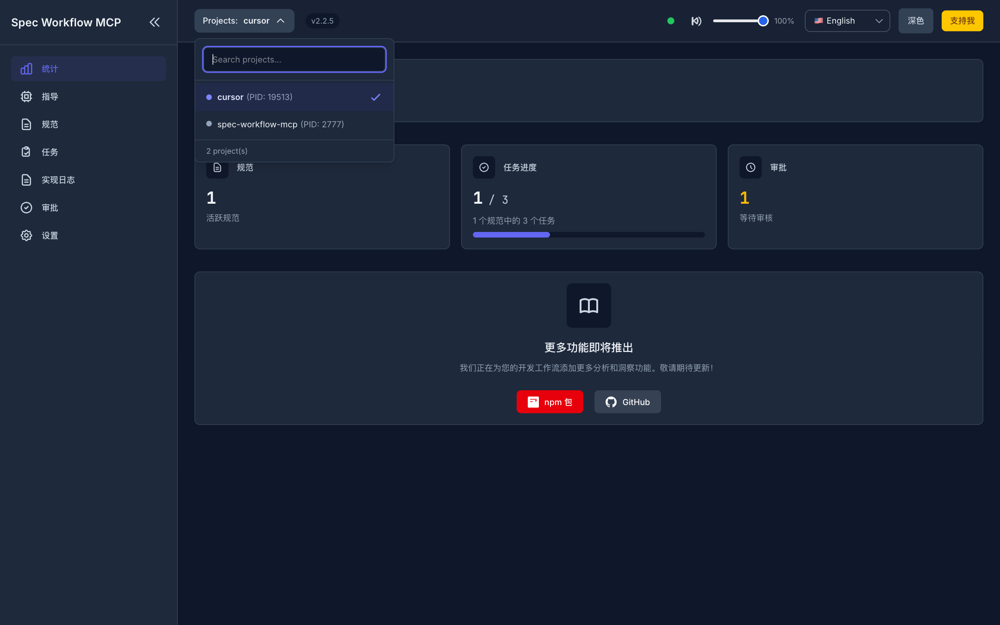

**操作步骤：**

1. 点击顶部的 `Projects: 项目名 ▾`
2. 在下拉列表里点要查看的项目；项目多时可以先在搜索框里输入名称
3. 切换后，所有页面显示的都是这个项目的数据

列表里每个项目后面的 `PID` 是它的 MCP 服务进程号。**只有正在运行的 MCP 服务才会出现在列表里**：如果找不到某个项目，先在那个项目里打开一个接了 spec-workflow 的 AI 会话。

### 1.3 查看更新日志

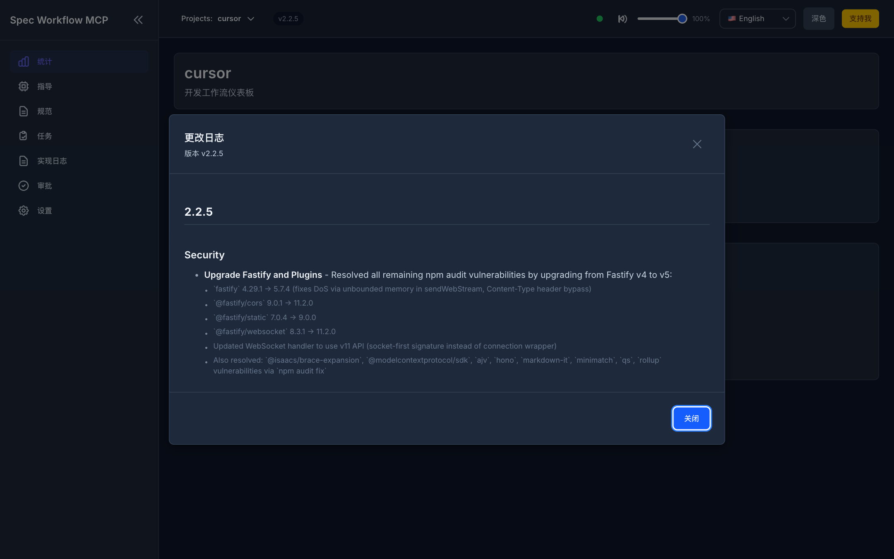

点顶部的版本号，会弹出这个版本更新了什么。点「关闭」或按 `Esc` 退出。

---

## 2. 统计页

**用途**：打开看板的第一眼，了解当前项目的整体情况。

| 卡片 | 含义 | 看到什么要处理 |
| --- | --- | --- |
| 规范 | 活跃规范的数量（不含已归档的） | — |
| 任务进度 | 已完成任务数 / 任务总数，下方进度条 | 长期不动，说明 AI 卡住了或忘了更新任务状态 |
| 审批 | 等待你审核的文档数，大于 0 时显示为橙色 | **大于 0 就要去「审批」页处理**，否则 AI 一直在等 |

页面下方的「更多功能即将推出」是作者的预告，`npm 包` 和 `GitHub` 按钮打开项目主页。

---

## 3. 指导页（steering 文档）

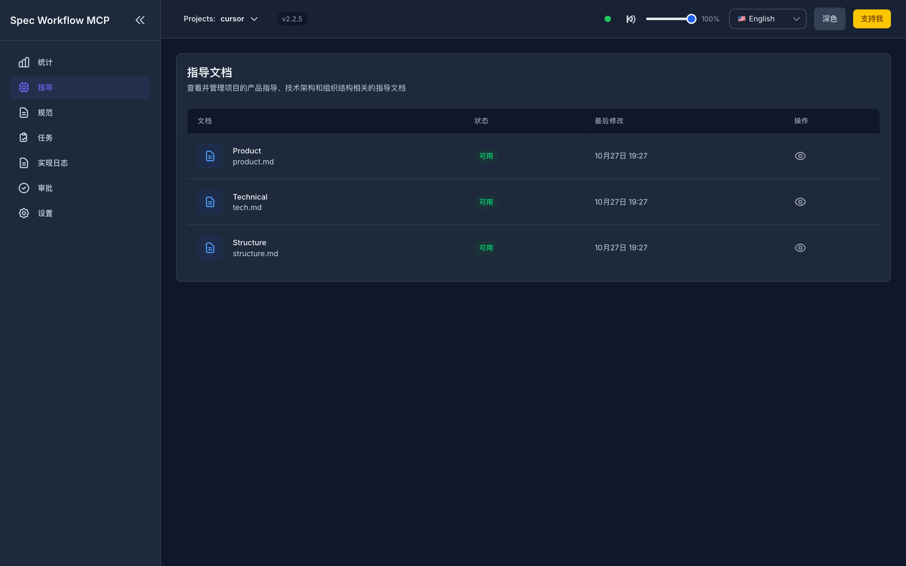

**用途**：查看和修改项目级说明文档。这三份文档描述整个项目，AI 每次写规范时都会参考：

| 文档 | 文件 | 写什么 |
| --- | --- | --- |
| Product | `product.md` | 产品定位、目标用户、主要功能 |
| Technical | `tech.md` | 技术栈、框架、部署方式、技术约束 |
| Structure | `structure.md` | 代码目录结构、命名规则 |

「状态」列显示「可用」表示文档已存在。还没有这几份文档时，可以对 AI 说「用 spec-workflow 为这个项目创建 steering 文档」。

### 3.1 查看和编辑 steering 文档

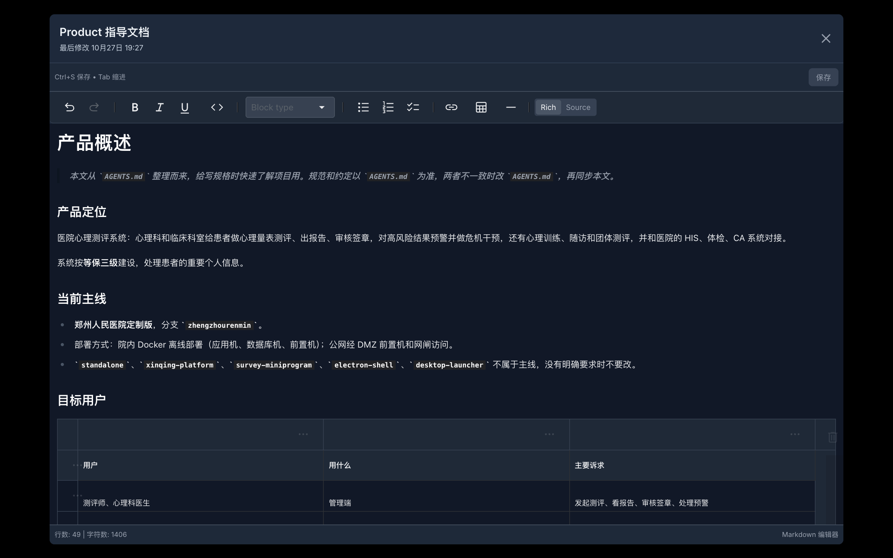

**操作步骤：**

1. 点击文档名（如 `product.md`）或右侧的眼睛图标，打开编辑器
2. 默认是 **Rich**（所见即所得）模式；点右上方 **Source** 切换到 Markdown 源码模式
3. 修改后点右上角「保存」，或按 `Ctrl+S`（Mac 上是 `⌘S`）
4. 点右上角 `×` 关闭

**注意：**

- 保存会直接改写项目里的文件，AI 下次写规范时就按新内容来
- 关闭时如果弹出「未保存的更改」，而你并没有想改任何东西，点「关闭」放弃即可。编辑器打开文档时会自动调整格式，有时会误判为有改动
- 大段修改建议用 Source 模式，避免富文本模式改乱表格

---

## 4. 规范页

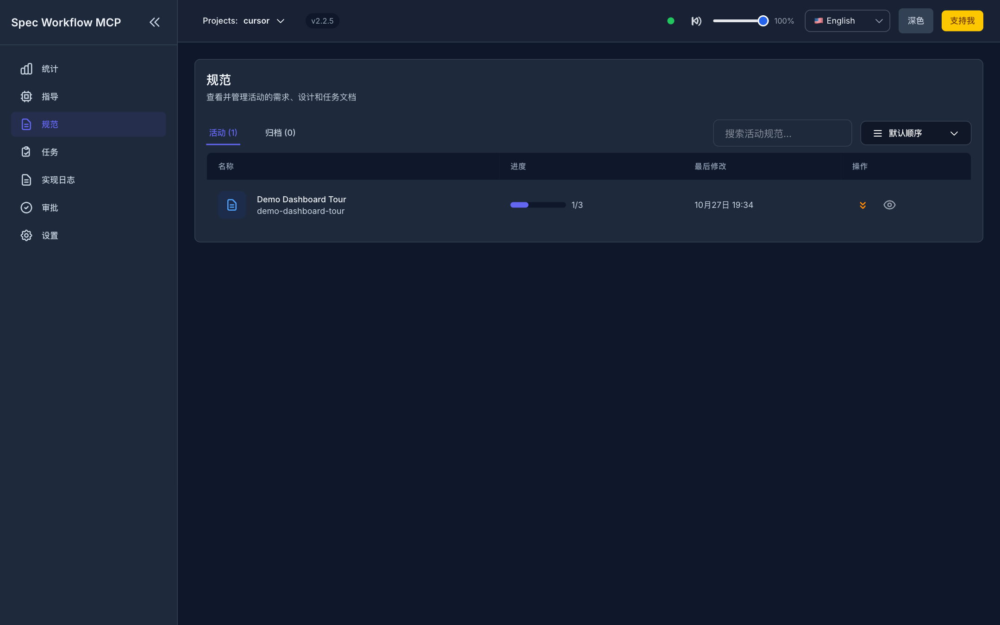

**用途**：查看所有规范（每个规范对应一个功能）及其进度，阅读或修改规范文档，归档已完成的规范。

### 4.1 界面说明

| 元素 | 作用 |
| --- | --- |
| `活动 (n)` / `归档 (n)` | 切换查看进行中的规范和已归档的规范 |
| 搜索框 | 按名称搜索规范 |
| 排序按钮 | 默认顺序、名称、进度、最后修改 |
| 进度条 | 该规范的任务完成情况，如 `1/3` |
| 操作列：归档图标 | 归档这个规范 |
| 操作列：眼睛图标 | 打开规范查看器 |

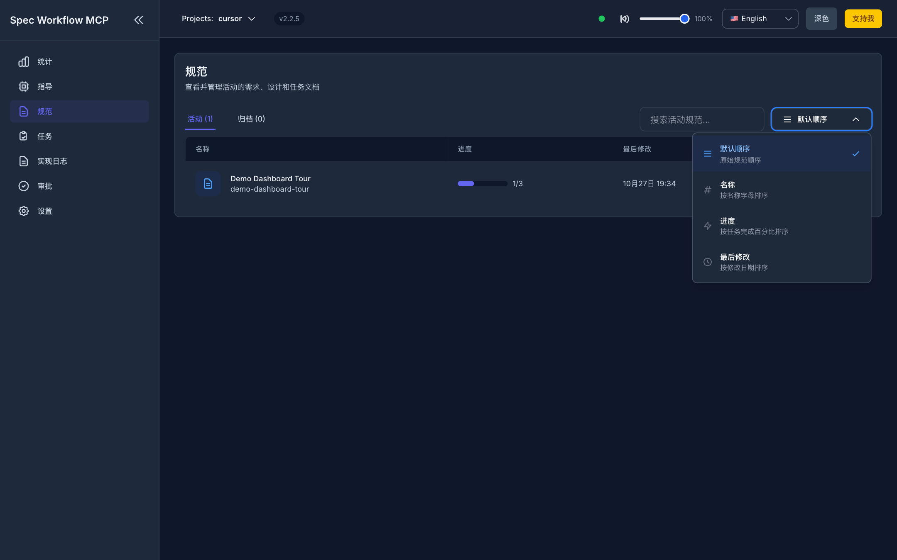

### 4.2 阅读或修改规范文档

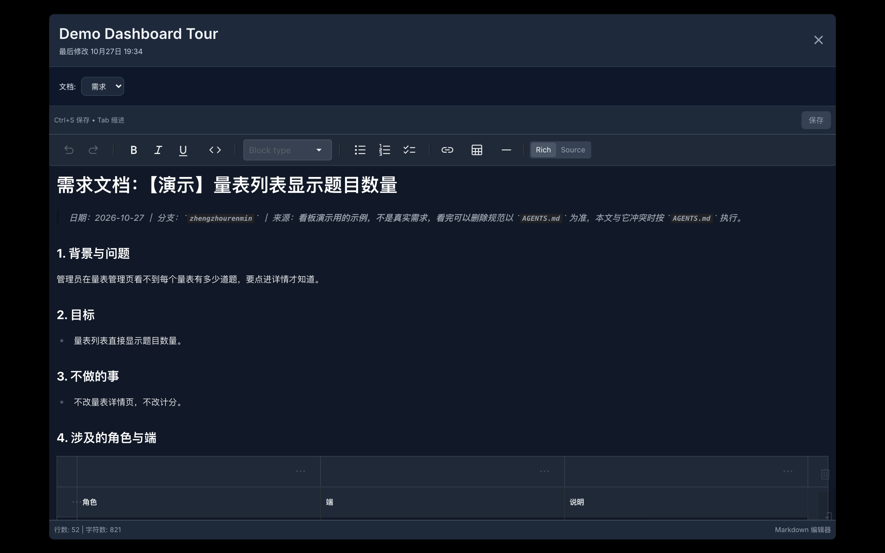

**操作步骤：**

1. 点击规范名称或眼睛图标，打开规范查看器
2. 用左上角「文档」下拉框切换 **需求 / 设计 / 任务** 三份文档
3. 编辑和保存方式与指导页相同（Rich / Source 模式，`Ctrl+S` 保存）

**注意：** 正在审批中的文档不要在这里改。要提修改意见，请到「审批」页用批注（见第 7 节），这样 AI 能看到你的具体意见并据此修改。

### 4.3 归档规范

**什么时候归档**：功能已经开发完、测试通过并上线之后。

**操作步骤：**

1. 在「活动」列表里找到该规范
2. 点击操作列的归档图标
3. 规范移到「归档」栏，对应文件夹从 `specs/` 移到 `archive/`，不再计入统计页的活跃规范数

归档的规范仍然可以在「归档」栏查看。

---

## 5. 任务页

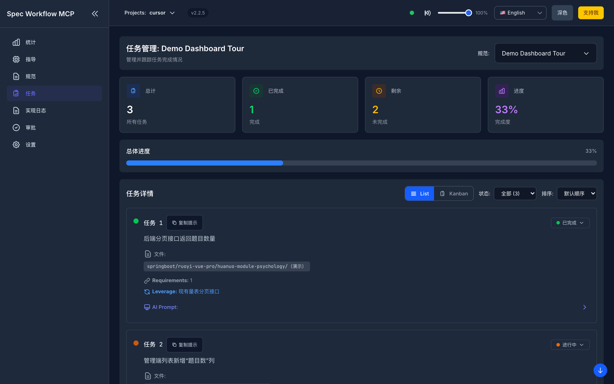

**用途**：跟踪某个规范下每个任务的进展，把任务交给 AI 执行。

### 5.1 界面说明

| 区域 | 作用 |
| --- | --- |
| 右上角「规范」下拉框 | 选择查看哪个规范的任务 |
| 统计卡片 | 总计、已完成、剩余、进度百分比 |
| 总体进度条 | 完成比例 |
| `List` / `Kanban` | 列表视图 / 看板视图 |
| 「状态」筛选 | 全部、待处理、进行中、已完成 |
| 「排序」 | 默认顺序、按状态、按任务 ID、按描述 |

每个任务卡片显示：

- **任务编号和标题**
- **复制提示**按钮：复制这个任务的完整执行提示词
- **状态标签**（右侧）：已完成 / 进行中 / 待处理
- **文件**：这个任务要改动的文件或目录
- **Requirements**：对应需求文档里的哪几条
- **Leverage**：可以复用的现有代码
- **AI Prompt**：给 AI 的详细指令，点开可展开

右下角的蓝色圆形按钮会跳到下一个待处理任务。

### 5.2 看板视图

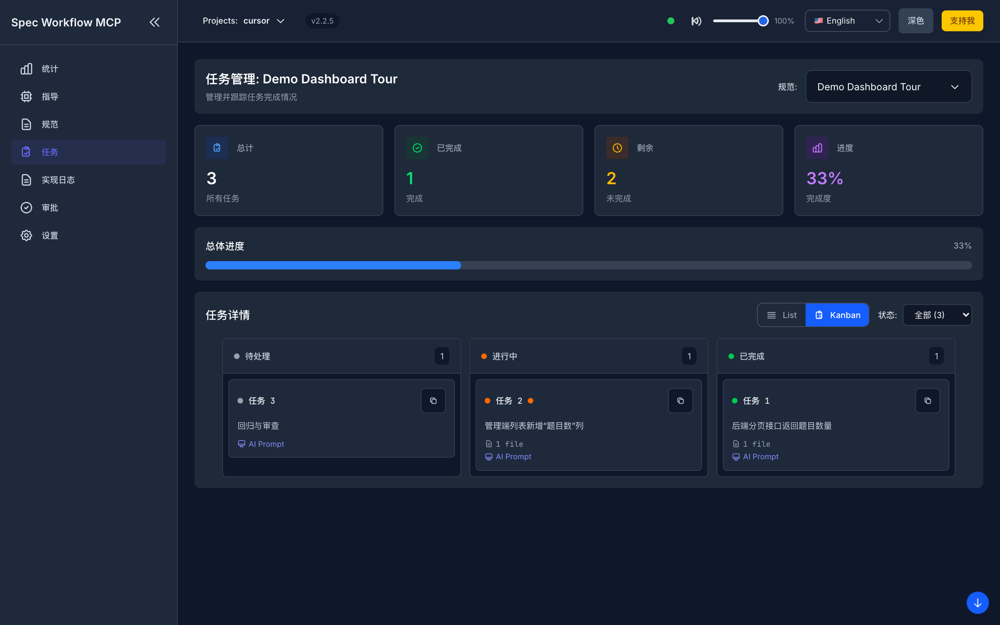

点 `Kanban` 切换成三列看板：待处理、进行中、已完成，适合一眼看清整体进展。

### 5.3 让 AI 执行某个任务

**操作步骤：**

1. 在任务卡片上点「复制提示」
2. 回到 AI 对话窗口，粘贴发送
3. AI 开始执行后，该任务状态变为「进行中」；完成后变为「已完成」，并在「实现日志」页留下记录

也可以直接对 AI 说「开始执行规范 xxx 的任务 2」，效果相同。

### 5.4 手动修改任务状态

点击任务右侧的状态标签可以手动改状态，修改会写回 `tasks.md`。

**使用规范：** 状态正常情况下由 AI 维护，只在以下情况手动改：

- AI 做完了却忘了标记已完成
- 任务决定不做了，或改由人工完成

不要把还没验证的任务手动标成「已完成」，否则 AI 会跳过它。

---

## 6. 实现日志页

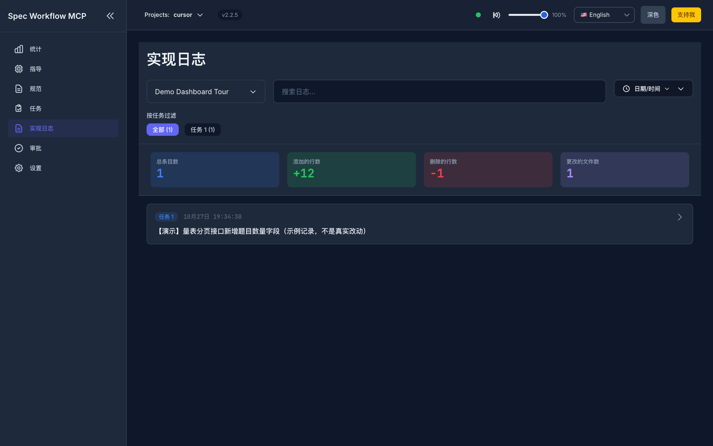

**用途**：查看每个任务完成时 AI 记录的改动明细。它是「做了什么」的档案，也是 AI 以后避免重复开发的依据：AI 做新任务前会先搜索这些日志，找到已有的接口和组件直接复用。

### 6.1 界面说明

| 元素 | 作用 |
| --- | --- |
| 规范下拉框 | 选择查看哪个规范的日志（必须先选） |
| 搜索框 | 按关键字搜索日志内容 |
| `日期/时间` | 排序方式 |
| 按任务过滤 | 只看某个任务的日志 |
| 统计卡片 | 总条目数、添加的行数、删除的行数、更改的文件数 |

### 6.2 查看一条日志的详情

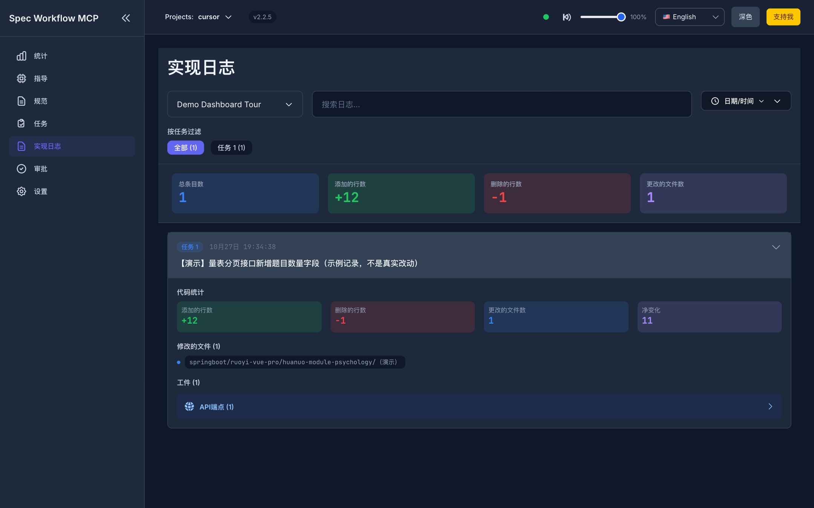

**操作步骤：**

1. 选择规范
2. 点击某条日志展开
3. 可以看到：
    - **代码统计**：增加、删除的行数，改动文件数，净变化
    - **修改的文件**：具体路径
    - **工件**：新增的 API 接口、组件、函数等，点开看详细说明

**使用规范：** 代码评审或排查问题时，先看这里了解 AI 改了哪些文件，再去看具体代码。如果某个已完成的任务没有日志，提醒 AI 补记。

---

## 7. 审批页（最重要）

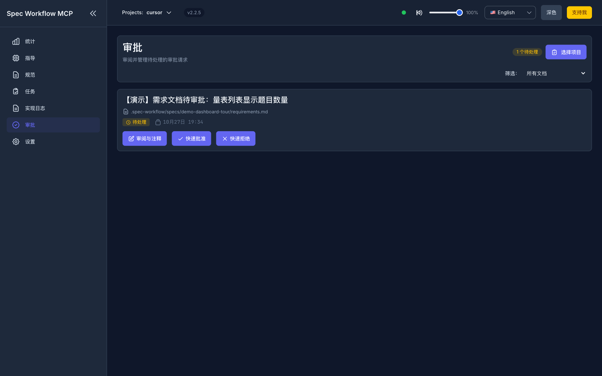

**用途**：审核 AI 提交的文档。AI 写完每份需求、设计、任务清单和 steering 文档后都会在这里提交审批，**你不处理，AI 就一直等着**。

有新审批时，看板右上角会弹出提示，并播放提示音。

### 7.1 界面说明

| 元素 | 作用 |
| --- | --- |
| `n 个待处理` | 等待审核的数量 |
| `选择项目` | 进入批量模式，可以一次批准或拒绝多个 |
| 「筛选」下拉框 | 所有文档，或只看某个规范的审批 |
| 审批卡片 | 标题、文件路径、状态（待处理）、提交时间 |
| `审阅与注释` | 打开完整审阅界面（推荐） |
| `快速批准` | 不打开文档直接通过 |
| `快速拒绝` | 不打开文档直接拒绝 |

### 7.2 审阅一份文档（标准流程）

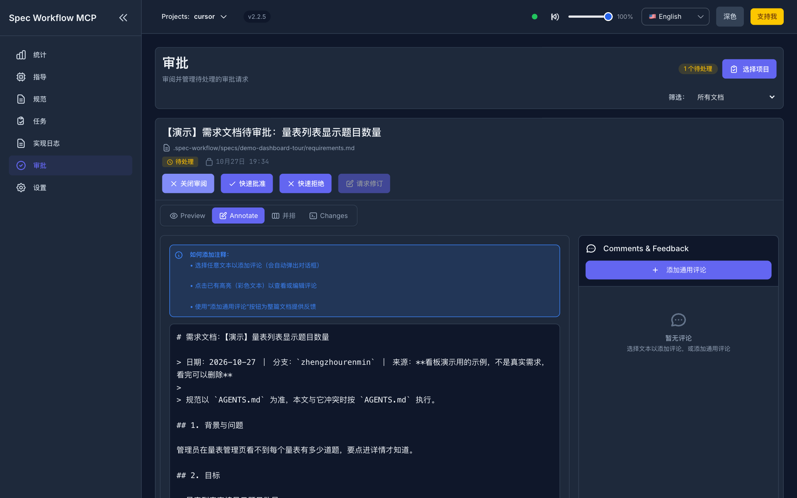

**操作步骤：**

1. 点击「审阅与注释」，打开审阅界面
2. 用文档上方的四个标签切换查看方式：
    - **Preview**：排版后的预览，适合通读
    - **Annotate**：批注模式，可以对具体文字写意见
    - **并排**：Markdown 源码和预览左右对照
    - **Changes**：和上一版的差异，文档被修改后重新提交时用它看改了什么
3. 逐段阅读。发现问题时添加批注：
    - **针对某段文字**：在 Annotate 模式下选中文字，会自动弹出评论框，写下意见
    - **针对整篇文档**：点右侧「添加通用评论」
    - 已写的批注会以彩色高亮显示，点击高亮可以查看或修改
4. 根据审阅结果，点顶部的一个按钮做决定：

| 按钮 | 什么时候用 | 结果 |
| --- | --- | --- |
| `快速批准` | 内容没问题 | AI 进入下一步（如需求通过后开始写设计） |
| `请求修订` | 方向对，但有地方要改 | AI 按你的批注修改后重新提交。**至少要写一条批注才能点**，没有批注时按钮是灰色的 |
| `快速拒绝` | 方向错了，需要推倒重来 | AI 停止当前文档，需要你在对话里说明新的要求 |
| `关闭` | 暂时不做决定 | 回到列表，审批仍是待处理 |

5. 回到 AI 对话窗口，告诉它「已批准，继续」或「已提修改意见」。**AI 不会自动发现审批结果变了**，需要你提醒一下

### 7.3 批量审批

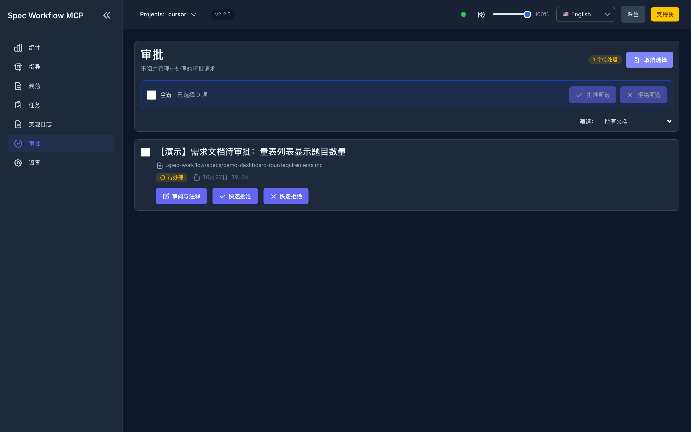

**操作步骤：**

1. 点右上角「选择项目」进入批量模式
2. 勾选要处理的审批，或勾选「全选」
3. 点「批准所选」或「拒绝所选」
4. 点「取消选择」退出批量模式

**使用规范：** 批量审批只适合你已经逐份看过的文档。需求和设计文档不要不看就批量通过。

### 7.4 审批规范

- **每份都要看**。需求错了，后面的设计、任务、代码全部跟着错，这是成本最低的纠错点
- **意见写具体**。「这里不对」不如「第 3 条验收标准要加上：导出文件名包含日期」
- **能修订就别拒绝**。方向基本对时用「请求修订」，AI 会保留可用的部分；「拒绝」只用于方向性错误
- **按顺序审**。同一个规范的需求、设计、任务是依次提交的，前一份通过后才会出现下一份
- **审完回对话说一声**，AI 才会继续

---

## 8. 设置页

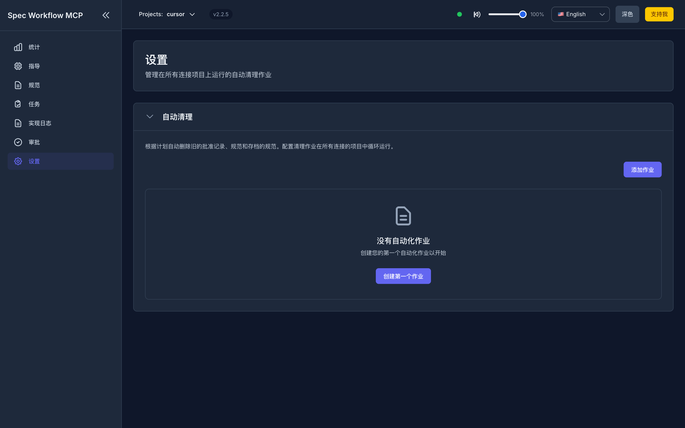

**用途**：配置自动清理任务，按计划自动删除旧数据。**设置对所有已连接的项目同时生效。**

### 8.1 新建自动清理任务

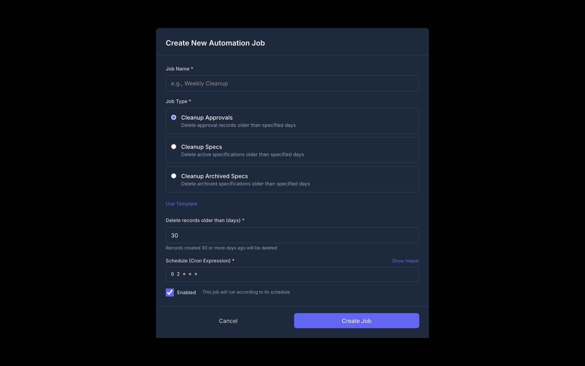

**操作步骤：**

1. 点「自动清理」展开，再点「添加作业」
2. 填写表单：

| 字段 | 说明 |
| --- | --- |
| Job Name | 任务名称，如「每周清理旧审批」 |
| Job Type | Cleanup Approvals：删除旧的审批记录 Cleanup Specs：删除旧的**活动**规范 Cleanup Archived Specs：删除旧的**已归档**规范 |
| Use Template | 使用预设模板快速填写 |
| Delete records older than (days) | 删除多少天以前的记录，默认 30 |
| Schedule (Cron Expression) | 运行时间，默认 `0 2 * * *` 表示每天凌晨 2 点。点 Show Helper 可以看写法说明 |
| Enabled | 勾选后按计划自动运行 |

3. 点「Create Job」保存；点「Cancel」放弃

### 8.2 使用规范

- **自动清理是直接删除文件，删除后不能恢复。** 规范如果没有提交到 git，就会永久丢失
- 推荐只开启 **Cleanup Approvals**（清理 30 天以前的审批记录），审批记录只是过程数据
- **不建议开启 Cleanup Specs**：它会删除还在进行中的规范，长期项目里很容易误删
- 如果要清理已归档规范，先确认 `.spec-workflow/` 已经提交到 git，天数设得长一些（如 180 天）

---

## 9. 典型操作流程

### 9.1 一个新功能从提出到上线

| 步骤 | 你在哪里操作 | 做什么 |
| --- | --- | --- |
| 1 | AI 对话 | 说「用 spec-workflow 创建一个规范：<功能描述>」 |
| 2 | 看板 → 审批 | 审阅需求文档 → 批准或请求修订 |
| 3 | AI 对话 | 说「已批准，继续」 |
| 4 | 看板 → 审批 | 审阅设计文档 → 批准或请求修订 |
| 5 | AI 对话 | 说「已批准，继续」 |
| 6 | 看板 → 审批 | 审阅任务清单 → 批准或请求修订 |
| 7 | 看板 → 任务 | 逐个点「复制提示」发给 AI，或让 AI 依次执行全部任务 |
| 8 | 看板 → 任务 / 实现日志 | 跟踪进度，查看每个任务的改动记录 |
| 9 | 看板 → 规范 | 全部任务完成并上线后，归档该规范 |

### 9.2 每天打开看板时的检查顺序

1. **统计页**：看「审批」数是否大于 0
2. **审批页**：处理所有待审批文档
3. **任务页**：看进行中的任务有没有长时间卡住
4. **实现日志页**：抽查最近完成任务的改动

### 9.3 需求中途变了

1. 在 AI 对话里说明变化，让 AI 修改需求文档（或设计文档）
2. 在看板「审批」页审阅修改后的文档，用 **Changes** 标签看改了哪里
3. 批准后，让 AI 用 `refresh-tasks` 更新任务清单，已完成的任务会保留
4. 在「审批」页审阅新的任务清单

---

## 10. 使用规范汇总

**推荐做法**

- 看板一直开着，打开提示音，新审批来了能及时处理
- 每份文档都通过「审阅与注释」认真看完再决定
- 意见用批注写在具体位置，写清楚要改成什么
- 审批完回 AI 对话说一声
- 功能上线后及时归档，保持活动列表干净
- 把 `.spec-workflow/` 提交到 git，规范和日志就有了版本记录

**避免的做法**

- 不看内容就「快速批准」需求和设计
- 在审批进行中直接改规范文件，AI 会看不到你的意见
- 未经验证就手动把任务标为「已完成」
- 开启「Cleanup Specs」自动删除活动规范
- 同时运行多个看板

---

## 11. 常见问题

| 问题 | 原因 | 解决办法 |
| --- | --- | --- |
| 打开 `localhost:5000` 是 403 空白页 | 5000 端口被 macOS「隔空播放接收器」占用，看板不在这个端口 | 改用 `http://localhost:5001` |
| `localhost:5001` 打不开 | 看板的开机自启服务没有运行 | 终端执行 `launchctl kickstart -k gui/$(id -u)/com.pimzino.spec-workflow-dashboard` 重启看板；仍不行就查看日志 `~/.spec-workflow-mcp/dashboard.err.log` |
| 直接输入 `localhost:5001/manual` 显示 404 | 看板页面地址都要带 `#/` | 改用 `http://localhost:5001/#/manual`，或从左侧导航进入 |
| 项目下拉框里找不到我的项目 | 该项目没有正在运行的 spec-workflow MCP 服务 | 在该项目里打开一个接了 spec-workflow 的 AI 会话 |
| 审批通过了，AI 没动 | AI 不会自动轮询审批结果 | 回到对话说「已批准，继续」 |
| 「请求修订」按钮是灰色的 | 还没有写任何批注 | 先添加至少一条批注 |
| 关闭编辑器时提示有未保存更改，但我没改 | 编辑器打开时自动调整了格式 | 点「关闭」放弃，文件不会被改动 |
| 任务进度不对 | `tasks.md` 格式被改乱，或 AI 忘了更新状态 | 检查任务是否为 `- [ ] 1. 标题` 格式；或在任务页手动改状态 |
| 页面数据不刷新 | 顶部圆点不是绿色，连接断了 | 刷新浏览器页面；仍不行就按上面的方法重启看板 |
| 界面语言不对 | 浏览器语言设置不同 | 顶部语言下拉框选「🇨🇳 中文」 |
